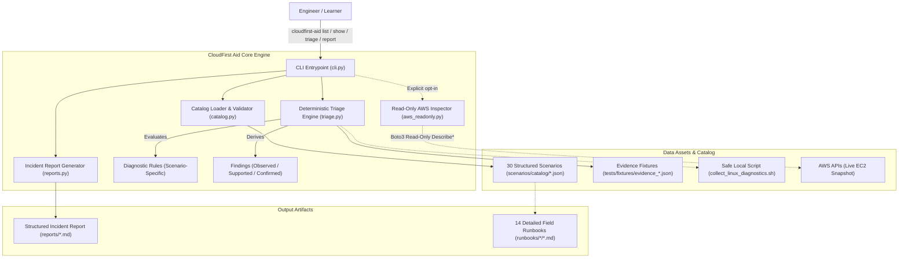
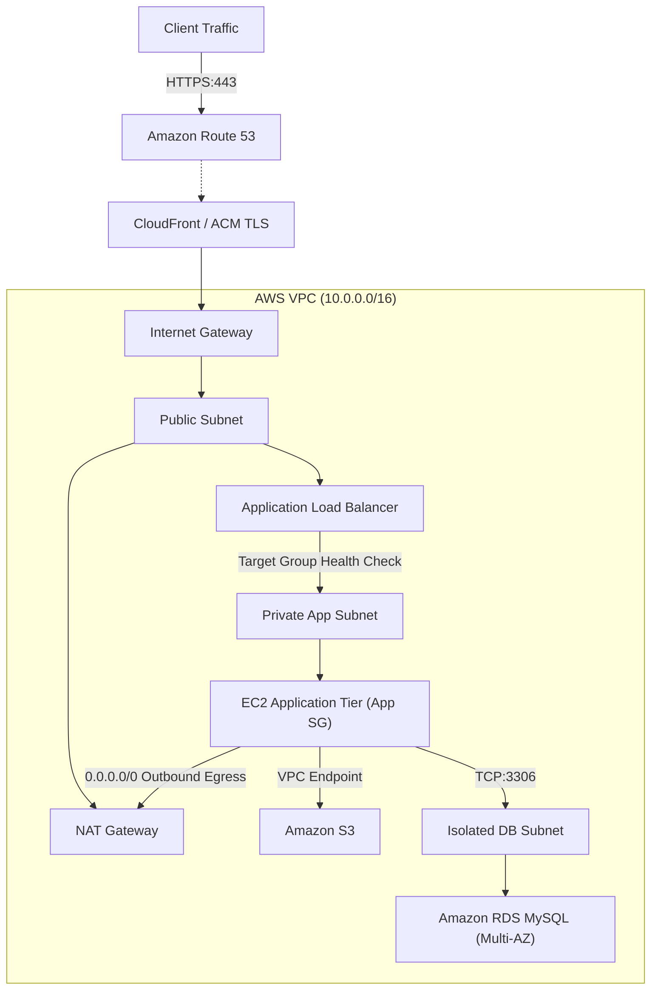

# CloudFirst Aid

**AWS Cloud Support & Linux Systems Troubleshooting Lab**

[](https://github.com/sameerhdevops/cloudfirst-aid/actions/workflows/tests.yml)
[](https://www.python.org/)
[](LICENSE)
[](docs/adr/ADR-001_offline_first_architecture.md)

CloudFirst Aid is a local-first troubleshooting lab, diagnostic CLI, and practical field guide for engineers preparing for entry-level AWS Cloud Support, Linux Systems Administration, and junior Cloud Operations roles.

It teaches and demonstrates how an engineer investigates an operational issue, collects diagnostic evidence, narrows down candidate root causes, selects a safe remediation, verifies the outcome, and documents the incident.

> **Target Audience & Purpose:** Developed primarily for technical interviewers and hiring managers evaluating freshers and junior cloud engineers. It provides concrete, code-level evidence of real troubleshooting knowledge without requiring paid AWS resources or claiming fictitious production experience.

---

## What Actually Works

- **30 Troubleshooting Scenarios:** Structured incident catalog across 6 categories (EC2, Linux, VPC Networking, Application, IAM/S3, Monitoring).
- **14 Detailed Runbooks:** Detailed troubleshooting guides covering diagnostic logic, command explanations, root-cause differentiation, remediation, verification, and interview questions.
- **Deterministic Diagnostic Engine:** Evaluates structured evidence fixtures against diagnostic rules to derive findings (`OBSERVED`, `SUPPORTED`, `CONFIRMED`) with deterministic rules whose conclusions depend on the supplied evidence.
- **Incident Report Generator:** Compiles scenarios, evidence items, and findings into structured Markdown post-mortem incident reports.
- **Automated Quality Gates:** Full unit test suite (51 tests passing), Ruff static linting, and multi-version Python CI (3.10 - 3.14).
- **Local-First Workflow:** Scenario browsing, fixture-based triage, and tests run without deployed AWS resources or AWS credentials. Optional live EC2 inspection uses read-only AWS APIs and requires your own AWS configuration.

---

## Architecture Overview



For full system design and architecture decision records, see the [Architecture Guide](docs/architecture.md) and [Architecture Decision Records](docs/adr/).

---

## Quick Start

### 1. Clone & Set Up Local Environment
```bash
git clone https://github.com/sameerhdevops/cloudfirst-aid.git
cd cloudfirst-aid

# Windows (PowerShell):
python -m venv .venv
.\.venv\Scripts\Activate.ps1

# Linux / macOS (Bash):
python3 -m venv .venv
source .venv/bin/activate

# Install in editable mode with development dependencies:
pip install -e ".[dev]"
```

### 2. Verify Installation
```bash
cloudfirst-aid --version
# Output: cloudfirst-aid 0.1.0

cloudfirst-aid validate
# Output: OK: Catalog is structurally valid. Total Scenarios: 30
```

---

## Terminal Walkthrough: Investigating an Incident

### Step 1: List Available Scenarios
```text
$ cloudfirst-aid list --category ec2

CloudFirst Aid - Scenario Catalog (30 scenarios)

ID         CATEGORY       SEVERITY    DIFFICULTY      DEMO    TITLE                                     
---------  -------------  ----------  --------------  ------  ------------------------------------------
CFA-001    ec2            HIGH        Beginner        [DEMO]  EC2 SSH Connection Times Out              
CFA-002    ec2            HIGH        Beginner          -     SSH Returns Permission Denied (publickey) 
CFA-003    ec2            CRITICAL    Intermediate      -     EC2 Instance Fails Status Check (1/2 or...
CFA-004    ec2            HIGH        Beginner          -     EC2 Running but Application Unreachable   
CFA-005    ec2            HIGH        Intermediate      -     EC2 Outbound Internet Access Fails        
```

### Step 2: Show Diagnostic Sequence for CFA-001
```text
$ cloudfirst-aid show CFA-001

==============================================================================
[CFA-001] EC2 SSH Connection Times Out
==============================================================================
Category:   Ec2 | Severity: HIGH | Difficulty: Beginner
Prerequisites: Amazon Linux 2 / 2023 EC2 instance in a public subnet with an attached Elastic IP.

[REPORTED SYMPTOM]
  Engineer attempts to connect to an Amazon EC2 instance via SSH (`ssh -i key.pem ec2-user@203.0.113.10`)
  and receives: 'ssh: connect to host 203.0.113.10 port 22: Connection timed out'.

[INITIAL OBSERVATIONS]
  * SSH client hangs for approximately 30-60 seconds before printing 'Connection timed out'.
  * The instance shows 'running' state in the AWS Management Console.
  * No TCP handshake is completed.

[RECOMMENDED INVESTIGATION SEQUENCE]
  Step 1: Verify Instance State and Public IP Assignment
    Command: aws ec2 describe-instances --instance-ids i-0123456789abcdef0 ...
    Purpose: Confirm instance is running and has a public IPv4 address assigned.
    Observe: State 'running' and non-empty PublicIpAddress.

  Step 2: Inspect Inbound Security Group Rules for Port 22
    Command: aws ec2 describe-security-groups --group-ids sg-0123456789abcdef0 ...
    Purpose: Verify an ingress rule exists allowing TCP port 22 from your current public IP.
    Observe: Check IpRanges CIDR against your public IP.
```

### Step 3: Run Deterministic Triage Against Evidence
```text
$ cloudfirst-aid triage CFA-001

Evaluating Diagnostic Rules for [CFA-001] EC2 SSH Connection Times Out
Loaded 3 evidence fixture item(s).

--- Diagnostic Findings ---

Finding 1: [OBSERVED] SSH connection is timing out.
  Supported by: SIM-EVID-CFA001-01
  Reasoning:    The TCP handshake never completes. The packet is being dropped.

Finding 2: [OBSERVED] EC2 instance is in running state.
  Supported by: SIM-EVID-CFA001-02
  Reasoning:    The virtual machine is powered on; failure is occurring at network/firewall layer.

Finding 3: [CONFIRMED] Security group does not allow inbound SSH on port 22.
  Supported by: SIM-EVID-CFA001-03
  Reasoning:    The security group attached to the instance has no rule authorizing TCP port 22 ingress.
                Traffic is silently dropped by the AWS hypervisor.
```

### Step 4: Generate a Structured Incident Report
```bash
cloudfirst-aid report CFA-001 --output reports/incident_CFA-001.md
```
View generated report examples in [`examples/reports/`](examples/reports/).

---

## Scenario Catalog & Key Runbooks

CloudFirst Aid organizes 30 scenarios across 6 core operational categories. The 14 priority scenarios feature full, detailed step-by-step runbooks:

| Category | Priority Incidents & Runbooks | Key Skills Demonstrated |
|---|---|---|
| **EC2 & Compute** | • [EC2 SSH Connection Timeout (CFA-001)](runbooks/ec2/CFA-001_ssh_connection_timeout.md)<br>• [SSH Permission Denied (CFA-002)](runbooks/ec2/CFA-002_ssh_permission_denied.md)<br>• [EC2 Status Check Failures (CFA-003)](runbooks/ec2/CFA-003_ec2_status_checks.md) | Security Groups, OpenSSH key permissions, Hypervisor System vs. Instance status check differences |
| **Linux Administration** | • [Root Filesystem 100% Full (CFA-010)](runbooks/linux/CFA-010_linux_disk_full.md)<br>• [Inode Exhaustion (CFA-011)](runbooks/linux/CFA-011_linux_inode_exhaustion.md)<br>• [High Memory & OOM-Killer (CFA-012)](runbooks/linux/CFA-012_high_cpu_memory_oom.md)<br>• [systemd Service Failure (CFA-013)](runbooks/linux/CFA-013_systemd_service_failure.md) | `df -h` vs `df -i`, open deleted file descriptors (`lsof`), kernel `oom_score`, port conflict resolution (`ss -tlnp`) |
| **VPC Networking** | • [ALB Unhealthy Targets (CFA-017)](runbooks/networking/CFA-017_alb_unhealthy_targets.md)<br>• [NAT Gateway in Private Subnet (CFA-018)](runbooks/networking/CFA-018_private_subnet_nat_gateway.md)<br>• [VPC DNS Resolution Failure (CFA-019)](runbooks/networking/CFA-019_vpc_dns_resolution.md) | Target Group health check codes, NAT Gateway subnet placement, `enableDnsSupport` VPC attribute |
| **IAM & Storage** | • [EC2 IAM Instance Profile for S3 (CFA-006)](runbooks/aws-services/CFA-006_ec2_s3_instance_profile.md)<br>• [S3 Bucket Policy Explicit Deny (CFA-020)](runbooks/aws-services/CFA-020_s3_bucket_policy_access_denied.md) | IMDSv2 token retrieval, IAM resource ARN scoping, explicit Deny precedence in S3 bucket policies |
| **Web & Application** | • [HTTP 502 Bad Gateway (CFA-008)](runbooks/aws-services/CFA-008_website_502_bad_gateway.md) | Reverse proxy upstream sockets, HTTP 502 vs. 504 differentiation, backend daemon supervision |
| **Cloud Databases** | • [RDS Database Connectivity Timeout (CFA-024)](runbooks/aws-services/CFA-024_rds_connectivity_timeout.md) | DB security group ingress referencing, multi-tier isolation, TCP socket validation via netcat |

For the complete 30-scenario matrix, see [Scenario Catalog Matrix](docs/scenario-catalog.md).

---

## Reference Architecture (Web Application Tier)

> **Notice:** The diagram below illustrates a standard production reference architecture used in CloudFirst Aid's troubleshooting scenarios. It does **not** represent an active deployment or incur cloud charges.



---

## Evidence Provenance & Safety Principles

CloudFirst Aid strictly tracks and separates diagnostic evidence:
1. **`[SIMULATED]` Fixtures:** Carefully crafted diagnostic fixtures shipped with the repository reproducing real errors. Marked clearly in all reports to avoid confusion with live systems.
2. **`[LOCAL]` Diagnostics:** Read-only host information collected safely using [`scripts/collect_linux_diagnostics.sh`](scripts/collect_linux_diagnostics.sh).
3. **`[LIVE_AWS]` Inspection (Optional):** Strictly read-only API calls (`Describe*`, `Get*`) via `cloudfirst-aid inspect-ec2 <ID>`. Never mutates infrastructure or creates resources.

### Automated Credential Redaction
All evidence output is filtered through our redaction engine (`src/cloudfirst_aid/evidence.py`), automatically masking AWS Access Key IDs (`AKIA...`), secret credentials, and 12-digit account numbers.

Read our full [Evidence Policy](docs/evidence-policy.md) and [Boundaries & Limitations](docs/limitations.md).

---

## Running the Automated Test Suite

CloudFirst Aid is backed by 51 unit tests verifying catalog integrity, CLI commands, diagnostic rules, report formatting, and secret redaction.

```bash
# Run test suite:
pytest tests/unit -v

# Run static linting:
ruff check src tests

# Run complete validation suite:
# On Windows (PowerShell):
powershell -ExecutionPolicy Bypass -File scripts\validate.ps1

# On Linux / macOS (Bash):
bash scripts/validate.sh
```

---

## Technology Stack & Design Decisions

- **Python 3.10+ (Standard Library Centric):** Built using plain dataclasses and standard library tools (`argparse`, `json`, `pathlib`) for zero bloat, high execution speed, and cross-platform reliability.
- **Ruff:** Lightning-fast linting and code quality enforcement.
- **Pytest:** Comprehensive unit testing with mocked AWS interfaces.
- **GitHub Actions:** Multi-version CI verifying Python 3.10 through 3.14 on every commit.
- **Mermaid:** Native Markdown diagrams rendering directly on GitHub without heavyweight dependencies.

---

## Project Repository Structure

```
cloudfirst-aid/
├── .github/workflows/tests.yml   # Multi-version CI quality gates
├── docs/
│   ├── architecture.md           # System design & component guide
│   ├── getting-started.md        # Comprehensive setup walkthrough
│   ├── scenario-catalog.md       # 30-scenario mapping matrix
│   ├── troubleshooting-method.md # 6-stage engineering framework
│   ├── evidence-policy.md        # Provenance & secret redaction policy
│   ├── limitations.md            # Transparent boundaries & honesty guide
│   ├── adr/                      # Architecture Decision Records (ADR-001, ADR-002)
│   └── diagrams/                 # Editable Mermaid architecture sources (.mmd)
├── examples/
│   └── reports/                  # Generated sample post-mortem reports
├── runbooks/
│   ├── ec2/                      # EC2 & SSH field runbooks
│   ├── linux/                    # Linux OS & storage field runbooks
│   ├── networking/               # VPC & ALB field runbooks
│   └── aws-services/             # S3, IAM, & RDS field runbooks
├── scenarios/catalog/            # 30 structured JSON scenario definitions
├── scripts/
│   ├── collect_linux_diagnostics.sh # Safe local Linux diagnostic script
│   ├── validate.ps1              # Local PowerShell validation suite
│   └── validate.sh               # Local Bash validation suite
├── src/cloudfirst_aid/           # Core Python package
│   ├── cli.py                    # Command-line interface
│   ├── catalog.py                # Catalog loading & schema validation
│   ├── models.py                 # Plain dataclasses (Scenario, Finding, Evidence)
│   ├── triage.py                 # Deterministic diagnostic rules engine
│   ├── evidence.py               # Fixture loading & secret redaction
│   ├── reports.py                # Audit report markdown compiler
│   └── aws_readonly.py           # Optional read-only AWS inspection
├── tests/
│   ├── fixtures/                 # Deterministic evidence JSON fixtures
│   └── unit/                     # Automated unit test suite
├── AGENTS.md                     # Multi-agent roles & delegation records
├── CHANGELOG.md                  # Release version history
├── CONTRIBUTING.md               # Contribution standards
├── LICENSE                       # MIT License
├── pyproject.toml                # Project packaging & tool configuration
└── SECURITY.md                   # Vulnerability reporting & safety invariants
```

---

## Primary Technical References

- [AWS EC2 Troubleshooting Guide](https://docs.aws.amazon.com/AWSEC2/latest/UserGuide/troubleshooting.html)
- [AWS EC2 SSH Connection Troubleshooting](https://docs.aws.amazon.com/AWSEC2/latest/UserGuide/TroubleshootingInstancesConnecting.html)
- [AWS S3 Access Denied Troubleshooting](https://docs.aws.amazon.com/AmazonS3/latest/userguide/troubleshoot-access-denied.html)
- [AWS ALB Target Health Checks](https://docs.aws.amazon.com/elasticloadbalancing/latest/application/target-group-health-checks.html)
- [AWS VPC DNS Support](https://docs.aws.amazon.com/vpc/latest/userguide/vpc-dns.html)
- Upstream Linux Manual Pages (`man df`, `man ss`, `man systemctl`, `man journalctl`, `man top`, `man lsof`)

---

## Author & License

Developed by **sameerhdevops** as a practical engineering portfolio project for AWS Cloud Support and Linux systems engineering.

Released under the [MIT License](LICENSE).
