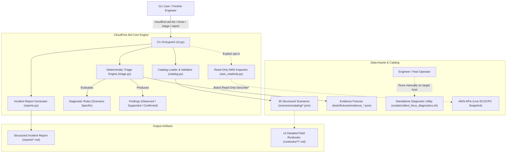
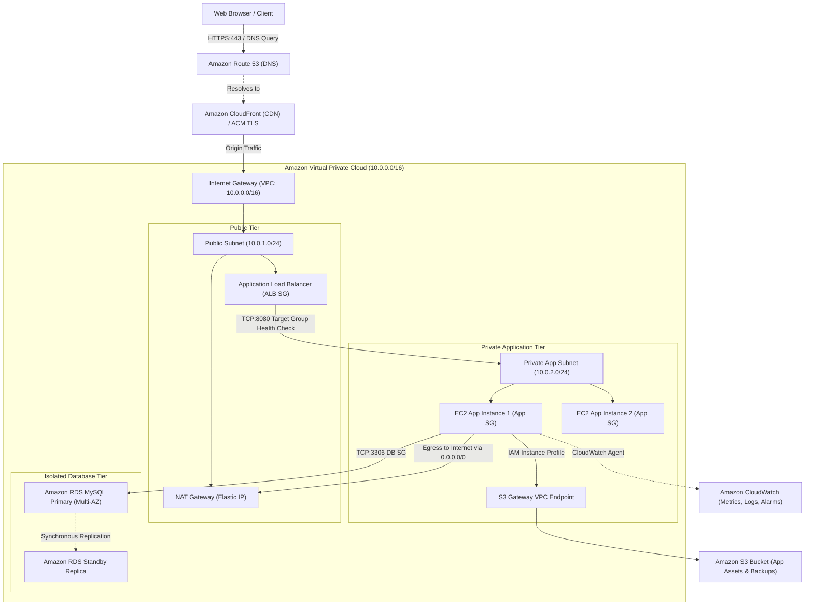
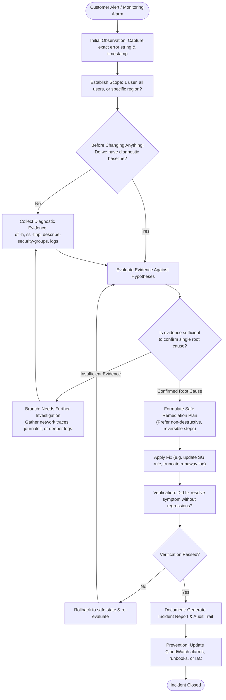
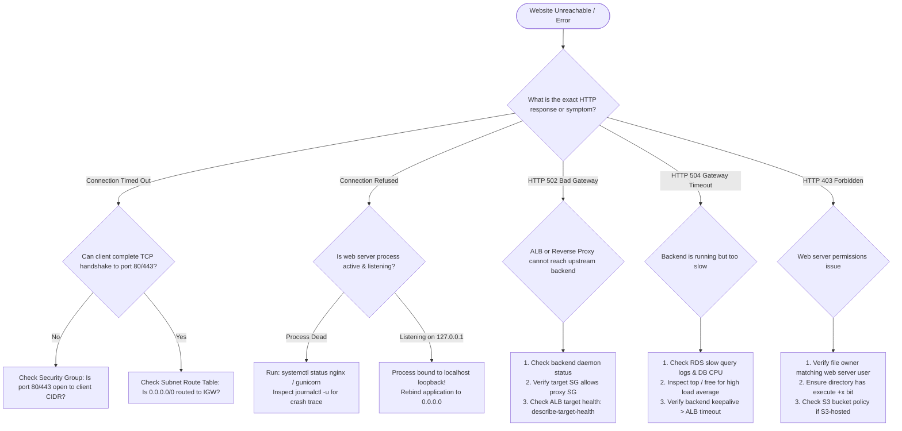

# CloudFirst Aid Architecture Diagrams

This directory contains editable [Mermaid](https://mermaid.js.org/) source files for the architecture, cloud infrastructure references, and troubleshooting workflows used in CloudFirst Aid.

GitHub natively renders Mermaid code blocks in Markdown. You can also view or edit these diagrams using the online [Mermaid Live Editor](https://mermaid.live).

---

## Diagram List

| Diagram | Source File | Description |
|---|---|---|
| **A. Project Architecture** | [`architecture.mmd`](architecture.mmd) | Component architecture, data flow from symptom to audit report |
| **B. Reference AWS Architecture** | [`aws_reference_architecture.mmd`](aws_reference_architecture.mmd) | Multi-tier AWS website architecture (ALB, EC2, RDS, VPC, S3) |
| **C. Incident Investigation Workflow** | [`incident_workflow.mmd`](incident_workflow.mmd) | Operational sequence from customer alert to post-incident review |
| **D. Troubleshooting Decision Tree** | [`troubleshooting_decision_flow.mmd`](troubleshooting_decision_flow.mmd) | Diagnostic branching logic for website connectivity failures |

---

## Rendering in Markdown

Below are embedded renderings of each diagram.

### Diagram A: Project Architecture

---

### Diagram B: Reference AWS Website Architecture

> **Notice:** This is a reference architecture used to illustrate real-world troubleshooting scenarios. It does not require active cloud resources or incur AWS costs to use CloudFirst Aid.

---

### Diagram C: Incident Investigation Workflow

---

### Diagram D: Troubleshooting Decision Tree (Website Unreachable)

